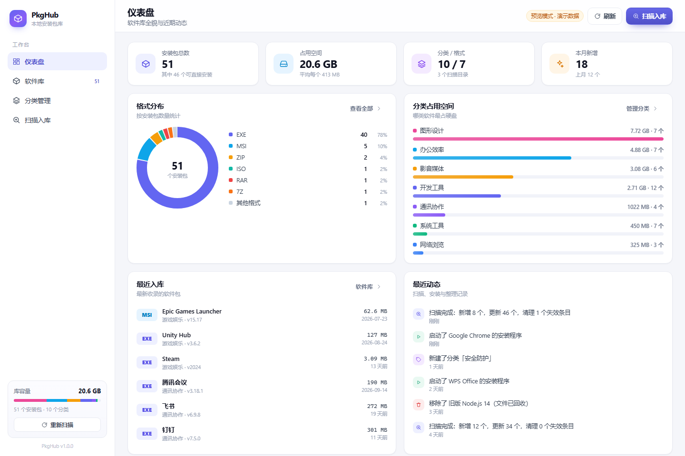
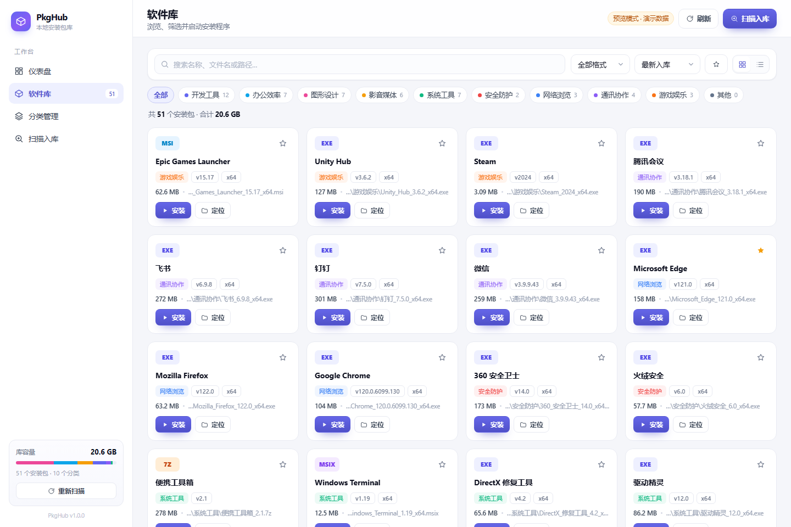
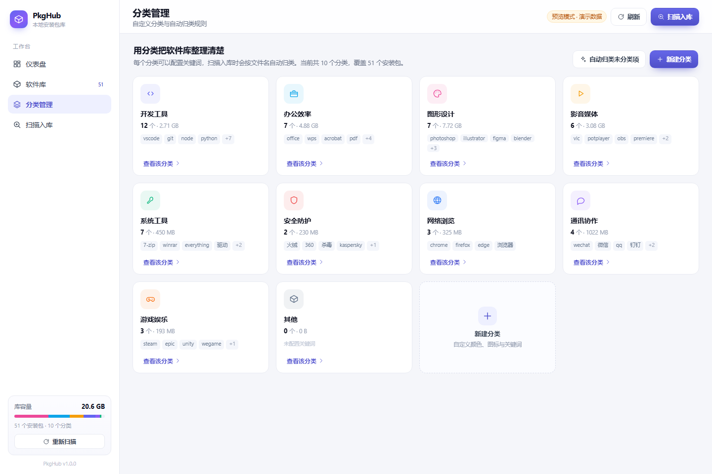
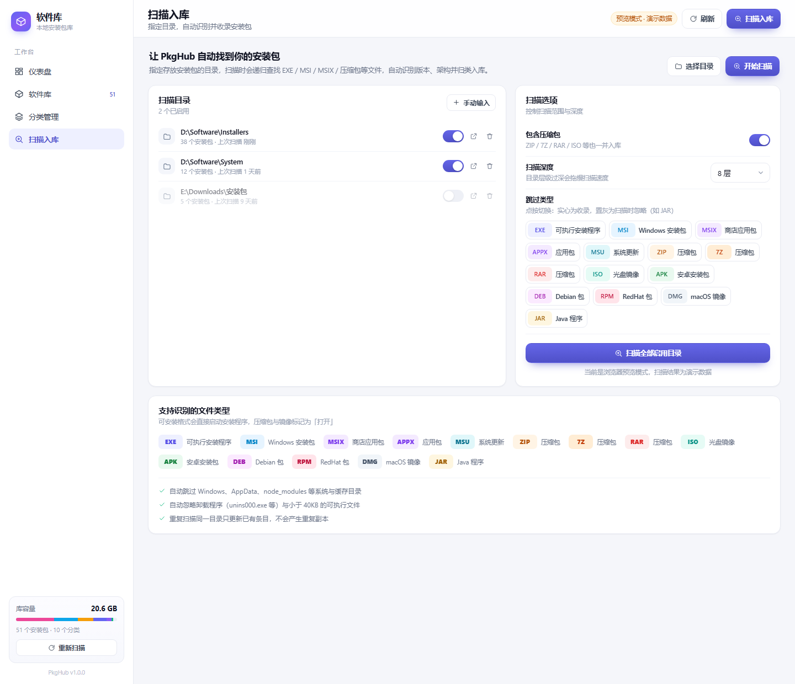

# PkgHub · 本地安装包管理器

一个使用 **Rust + Tauri 2 + React 18** 构建的 Windows 桌面应用，用于管理散落在硬盘各处的软件安装包：扫描指定目录，自动识别版本与架构、智能分类入库，并提供仪表盘总览与一键启动安装程序。

   

## 界面预览

| 仪表盘 | 软件库 |
| --- | --- |
|  |  |

| 分类管理 | 扫描入库 |
| --- | --- |
|  |  |

## 功能特性

- **软件库**：网格 / 列表双视图，展示体积、分类、版本、格式、架构；支持关键词搜索（名称 / 文件名 / 路径）、按分类 / 格式 / 收藏筛选、多种排序
- **一键安装**：EXE 直接启动、MSI 调用 `msiexec /i`、MSIX / APPX 交给系统安装器，支持 UAC 管理员安装；压缩包与镜像标记为「打开」
- **智能分类**：内置 10 个分类（开发工具、办公效率、图形设计、影音媒体、系统工具、安全防护、网络浏览、通讯协作、游戏娱乐、其他），基于关键词自动归类；分类的颜色、图标、关键词均可自定义，并支持一键重新归类
- **目录扫描**：递归扫描指定目录，实时进度回显；从文件名解析版本号（`120.0.6099.130`、`v20.11.0` 及 alpha/beta/rc 后缀）与架构（x64 / x86 / ARM64）；自动清理磁盘上已不存在的失效条目
- **扫描选项**：包含压缩包开关、扫描深度（2~16 层）、跳过类型（14 种格式逐个切换收录 / 忽略，如不需要 JAR 就点灰它）；所有选项持久化存储，重启后仍生效
- **仪表盘**：总数 / 总体积 / 分类与格式数 / 本月新增指标卡，格式分布环形图，分类占用空间条形图，最近入库与活动时间线，占用空间 TOP5
- **详情面板**：完整元信息、改分类、重命名、备注、收藏、移除（移入回收站或仅移出库）
- **便携模式**：数据库默认生成在 exe 同目录，拷贝即走，不写注册表

## 环境要求

- Node.js ≥ 18（推荐 20+）
- Rust ≥ 1.89（MSVC 工具链，Windows 下需安装 Visual Studio Build Tools）
- Windows 10 / 11（应用目前面向 Windows：目录选择、提权启动、回收站均使用系统能力）

## 快速开始

```bash
# 安装依赖
npm install

# 开发模式（前端热重载 + Tauri 窗口）
npm run app:dev

# 打包 NSIS 安装程序
npm run app:build

# 仅构建前端 / 仅编译 Rust（产物内嵌前端资源，单文件可运行）
npm run build
cargo build --release   # 在 src-tauri/ 目录下执行

# 运行 Rust 单元测试
cargo test
```

构建产物：`src-tauri/target/release/pkghub.exe`（约 5 MB，免安装直接运行）。

## 项目结构

```
pkghub_desktop/
├── src/                        # 前端（React 18 + TypeScript + Vite 5）
│   ├── pages/                  # Dashboard / Packages / Categories / Scanner
│   ├── components/             # 图标、卡片、抽屉、图表等组件
│   └── lib/                    # API 封装、类型定义、工具函数、演示数据
├── src-tauri/                  # Rust 后端
│   └── src/
│       ├── commands.rs         # 26 个 Tauri 命令（查询/启动/删除/分类/扫描/设置）
│       ├── scanner.rs          # 目录扫描、版本解析、关键词归类（含单元测试）
│       ├── db.rs               # SQLite 建表、查询聚合（含单元测试）
│       └── models.rs
├── scripts/                    # 图标生成、演示数据、截图等辅助脚本
├── screenshots/                # 界面截图
└── dist/                       # 前端构建产物（release 构建时内嵌进 exe）
```

## 技术要点

- **数据存储**：SQLite（rusqlite bundled，WAL 模式），表结构为 `packages` / `categories` / `scan_dirs` / `activities` / `settings`
- **扫描规则**：自动跳过 `Windows`、`AppData`、`node_modules` 等系统与缓存目录；忽略卸载程序与小于 40KB 的可执行文件；以完整路径为唯一键，重复扫描只更新不重复入库
- **安全删除**：删除文件通过系统回收站完成（`Microsoft.VisualBasic.FileIO`），不做物理删除
- **跳过类型**：仅对之后的扫描生效，已入库条目不受影响，可手动移出
- **前端演示模式**：非 Tauri 环境（普通浏览器）下自动使用内置演示数据，便于 UI 开发与预览

## 常见问题

**Q: `cargo` 拉取依赖很慢或超时？**
国内网络建议为 Cargo 配置镜像源，例如在 `%USERPROFILE%\.cargo\config.toml` 中添加 [rsproxy.cn](https://rsproxy.cn) 稀疏镜像；GitHub 访问同理。

**Q: 编译报错 rustc 版本不满足？**
项目锁定 Tauri 2.11.x（支持 rustc 1.89）。若使用 rustc 1.90+，可在 `src-tauri/Cargo.toml` 中放开版本限制后执行 `cargo update`。

**Q: 直接 `cargo build`（debug）运行后窗口是空白？**
debug 构建从 `devUrl`（`http://127.0.0.1:1420`）加载页面，请先运行 `npm run dev`；或使用 `npm run app:dev` / `cargo build --release`（release 会内嵌 `dist/`）。

## Roadmap

- [ ] 批量操作（多选移出、批量改分类）
- [ ] 读取 PE 资源中的文件版本与产品名（替代纯文件名解析）
- [ ] 重复文件清理向导
- [ ] 软件库清单导入 / 导出（CSV、JSON）
- [ ] 深色主题与自定义标题栏
- [ ] macOS / Linux 支持

## License

[MIT](LICENSE)
